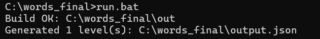
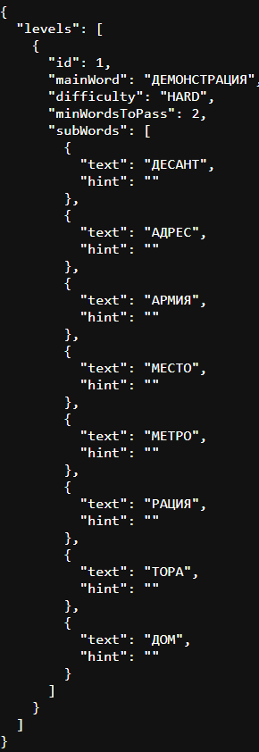

# Words from Word — Level Generator

A Java module that generates structured word-puzzle game levels in JSON format from a dictionary and a list of main words. For each main word, it filters valid subwords that can be formed from the main word's letters (respecting letter multiplicity), computes level difficulty, and outputs the resulting levels without exposing internal generation settings.

## Tech Stack

- **Java 21**
- **Google Gson 2.11.0** (JSON serialization/deserialization)
- **Java Collections Framework & Stream API**

## Project Structure

```text
├── src/main/java/words/
│   ├── Main.java            # CLI entry point
│   ├── LevelGenerator.java  # Core level generation, letter frequency & difficulty logic
│   ├── LevelInput.java      # Input DTOs & config validation (records)
│   ├── LevelOutput.java     # Output DTO wrapper
│   ├── Level.java           # Single level model
│   ├── SubWord.java         # Subword model (text + hint)
│   ├── Difficulty.java      # Difficulty enum (EASY, MEDIUM, HARD)
│   ├── JsonIO.java          # UTF-8 JSON file reader/writer
│   └── SelfTest.java        # Automated unit & performance checks
├── examples/
│   └── input.json           # Sample input dataset
├── docs/
│   └── prompts_log.md       # AI prompts and responses log
├── build.bat                # Windows build script
└── run.bat                  # Windows run script
```

## Input Format (`examples/input.json`)

```json
{
  "dictionary": ["десант", "адрес", "армия", "место", "метро", "стол", "соль", "дом", "рация", "тора", "магия", "гора"],
  "mainWords": ["ДЕМОНСТРАЦИЯ", "ВЗАИМНОСТЬ"],
  "config": {
    "minSubWordLength": 3,
    "minWordsToPass": 2,
    "difficultyThresholds": {
      "easyMaxMainWordLength": 7,
      "mediumMaxMainWordLength": 10,
      "easyMaxSubWords": 15,
      "mediumMaxSubWords": 30
    }
  }
}
```

> `config` controls filtering, passing thresholds, and difficulty calculation during generation and is excluded from the final JSON output.

## Output Format (`output.json`)

```json
{
  "levels": [
    {
      "id": 1,
      "mainWord": "ДЕМОНСТРАЦИЯ",
      "difficulty": "HARD",
      "minWordsToPass": 2,
      "subWords": [
        { "text": "ДЕСАНТ", "hint": "" },
        { "text": "АДРЕС", "hint": "" },
        { "text": "АРМИЯ", "hint": "" },
        { "text": "МЕСТО", "hint": "" },
        { "text": "МЕТРО", "hint": "" },
        { "text": "РАЦИЯ", "hint": "" },
        { "text": "ТОРА", "hint": "" },
        { "text": "ДОМ", "hint": "" }
      ]
    }
  ]
}
```

## Generation Rules

1. The subword exists in `dictionary`.
2. Its length is at least `minSubWordLength`.
3. It is not identical to `mainWord`.
4. It can be constructed from the letters of `mainWord` without exceeding any letter's multiplicity.
5. No duplicate subwords appear within the same level.
6. Case and the letter `Ё` are normalized (`toUpperCase(Locale.ROOT)` and `Ё` -> `Е`).
7. A level is included in the output only if `subWords.size() >= minWordsToPass`.

## How to Build & Run

> Make sure `lib/gson-2.11.0.jar` is present in the `lib/` folder before building.

1. **Compile:**
   ```bash
   build.bat
   ```
2. **Run with default paths (`examples/input.json` -> `output.json`):**
   ```bash
   run.bat
   ```
3. **Run with custom paths:**
   ```bash
   run.bat path/to/input.json path/to/output.json
   ```
4. **Run self-tests:**
   ```bash
   java -Dfile.encoding=UTF-8 -cp "out;lib/gson-2.11.0.jar" words.SelfTest
   ```

## Screenshots

**Running the generator (Build OK):**


**Generated output.json:**

# Weak Points of the "Words from word" Implementation

Below are the main limitations of the current project version and potential areas for improvement that are helpful to highlight during the project defense.

## 1. Basic Text Normalization

* **The Issue:** Normalization is limited to case conversion and replacing `Ё -> Е`.
* **Limitations:** Spaces, hyphens, apostrophes, rare Unicode characters, and morphological word forms are not handled.
* **How to Improve:** Implement comprehensive input string sanitization and normalization (filtering non-alphabetic characters, supporting configurable alphabet rules).

## 2. Simplified Difficulty and `minWordsToPass` Calculation

* **The Issue:** The difficulty level (`EASY`, `MEDIUM`, `HARD`) and the minimum number of words required to pass are calculated using a basic heuristic.
* **Limitations:** Letter rarity, the length of the discovered subwords, and the total number of possible combinations from the main word are not taken into account.
* **How to Improve:** Introduce a weighted difficulty score based on letter frequency, word lengths, and the total size of the resulting subword set.

## 3. Empty Hints (`hint: ""`) by Default

* **The Issue:** In the generated `output.json`, the `hint` field for each subword is populated as an empty string.
* **Limitations:** While the JSON schema is ready for game integration, actual hints for the player are missing.
* **How to Improve:** Integrate a dictionary of definitions/synonyms or generate basic hints (e.g., based on the first letter or word category).

## 4. Manual Build Without Maven/Gradle

* **The Issue:** Building and running the project rely on direct `javac`/`java` commands and hardcoded relative paths (`src/main/java/words/*.java`, `lib/gson-2.11.0.jar`, `examples/input.json`).
* **Limitations:** Moving the project or adding new dependencies requires manually managing the `classpath` and directory structure, and `.bat` scripts on Windows may be blocked by security policies (such as Smart App Control).
* **How to Improve:** Migrate the project to a standard build tool (Maven or Gradle) for automated dependency management and test execution.

## 5. Basic Edge-Case and Input Error Handling

* **The Issue:** In the event of malformed input JSON, a missing input file, or an empty dictionary, diagnostics are limited to standard exceptions.
* **Limitations:** It is not always immediately clear to the user which specific field in the input file is invalid.
* **How to Improve:** Add explicit validation for the input model (`LevelInput`) with descriptive error messages and expand the unit test suite in `SelfTest`.
## Known Limitations

- **Basic difficulty heuristic:** Difficulty relies solely on main word length and subword count rather than letter rarity or word frequency.
- **Empty hints by default:** `subWords[].hint` is initialized as `""` and requires an external dictionary/definition source to populate meaningful clues.
- **Simple normalization:** Only uppercase conversion and `Ё` -> `Е` replacement are applied; hyphenated or non-alphabetic entries are not stripped.
